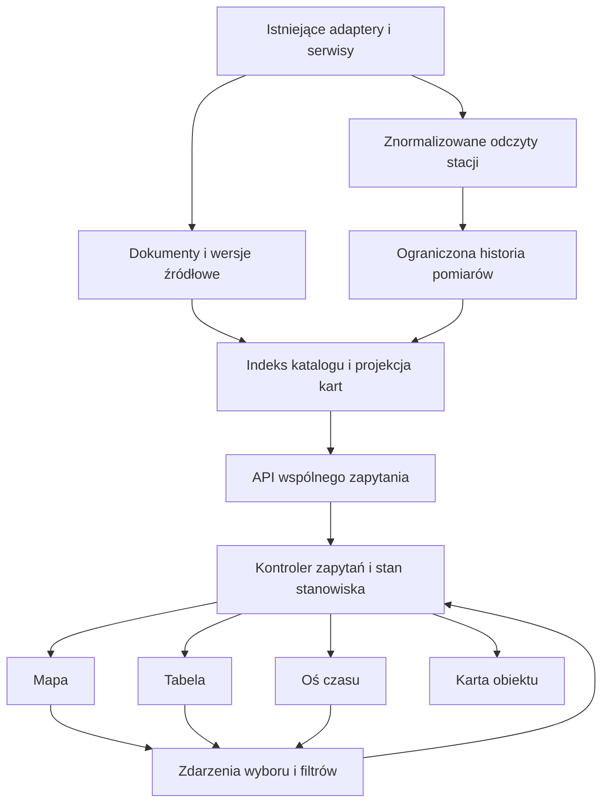

# WICI — plan stanowiska analitycznego, etap 1

Status: propozycja do realizacji; dokument nie oznacza wdrożenia funkcji. Data: 22.10.2026.
Punkt odniesienia: WICI 0.29.0, commit `7bcdf14`, schemat SQLite do migracji `014`.
Branch planu: `codex/wici-analysis-workspace-plan`.

## 1. Cel i rezultat etapu

Użytkownik pracuje na wspólnym katalogu obiektów. Wybór obiektu na mapie, w tabeli albo na osi czasu otwiera tę samą kartę szczegółów i zaznacza obiekt w pozostałych widokach. Wspólny zakres danych obejmuje typy obiektów, województwo, wyszukiwanie i czas. Użytkownik może zapisać konfigurację stanowiska i do niej wrócić.

Inspiracją z Palantira jest praca na obiektach z jawnym pochodzeniem danych, zachowanie kontekstu podczas przechodzenia między widokami oraz zapisywanie eksploracji. Ten etap ma dostarczyć użyteczne stanowisko do analizy sytuacji w Polsce na istniejących źródłach.

**Scenariusz odbiorowy:** użytkownik wybiera województwo i ostatnie 24 godziny, znajduje wodowskaz, otwiera jego kartę, wybiera dostępny wcześniejszy pomiar, ogląda odpowiadający mu punkt i wiersz, następnie przechodzi do komunikatu dotyczącego tego samego obszaru. Zapisuje filtry i układ. Po ponownym otwarciu aplikacji przywraca stanowisko, widzi aktualność danych oraz dostępny zakres lokalnej historii.

## 2. Zamknięty zakres funkcjonalny

| Typ | Tożsamość w WICI | Zakres etapu 1 |
|---|---|---|
| `communication` | `communication:<documents.id>` | Cztery istniejące źródła, aktualna zapisana wersja, wersje źródłowe, obszary, publikacja i ważność |
| `hydro_station` | `hydro_station:imgw:<id_stacji>` | Stacja, jej lokalizacja, stan wody, przepływ, temperatura i dostępne progi |
| `air_quality_station` | `air_quality_station:gios:<station_id>` | Stacja, stanowiska pomiarowe, oficjalny indeks, pomiary poszczególnych stanowisk |
| `area` | `area:prg:<admin_code>` | Województwa i powiaty z lokalnego PRG; obiekty referencyjne i nawigacja po obszarze |

Identyfikator dokumentu jest trwały w obrębie instalacji i jej kopii zapasowej. Nie jest identyfikatorem do scalania baz różnych instalacji. Identyfikatory stacji zachowują przestrzeń nazw dostawcy; zmiana nazwy nie tworzy nowego obiektu.

Wszystkie cztery typy otrzymują listę, kartę oraz reprezentację mapową, jeśli mają poprawną geometrię. Obszary są bezczasowym kontekstem; nie dostają fikcyjnych zdarzeń na osi. Podstawowy filtr zasięgu nadal obejmuje Polskę i województwa. Powiat można wyszukać, wybrać i pokazać na mapie, ale filtr powiatowy dla wszystkich warstw pozostaje poza etapem.

W zakresie są także: wyszukiwanie po nazwie/tytule/identyfikatorze, paginacja, sortowanie, wspólny stan zaznaczenia, historia pomiarów opisana w sekcji 6, zapis konfiguracji stanowiska oraz syntetyczne demo całego scenariusza.

Poza etapem: graf relacji, notatki i teczki analiz, ręczne hipotezy, alerty użytkownika, LLM, nowe źródła, rysowanie dowolnych obszarów, analiza przyczyn, prognozowanie, współpraca wieloosobowa, pełne odtworzenie stanu wiedzy z przeszłości i eksport raportów. Rozpoczęcie tego etapu nie przywraca dawnej kolejki zatwierdzania publikacji.

Samoloty, statki, trasy, kolej, autobusy, IODA, FIRMS i zobrazowania pozostają dostępne w Atlasie. Ich włączenie do wspólnego katalogu i zegara będzie osobnym rozszerzeniem po odbiorze tego etapu. To ogranicza liczbę różnych zasad retencji, tożsamości i czasu w pierwszej wersji.

## 3. Co istnieje i co trzeba zmienić

| Obecny element | Ustalenie z kodu | Plan zmiany |
|---|---|---|
| [app.py](../src/wici/app.py), `create_app()` | FastAPI tworzy serwisy, API i zabezpieczenia w jednym module | Dodać router stanowiska i serwis odczytu, korzystające z istniejącego cyklu życia aplikacji |
| [repository.py](../src/wici/repository.py), `list_communications()` | Cały zbiór aktualnych dokumentów jest przetwarzany i filtrowany w Pythonie; limit na końcu | Dodać indeks odczytu dla katalogu oraz paginację; zachować reguły dopuszczenia dokumentów |
| [communications.py](../src/wici/communications.py) | Reguły statusu, typów, obszarów i odnośników są już wydzielone | Wykorzystać te reguły w projekcji; status zależny od czasu obliczać dla jawnego czasu odniesienia |
| [hydro.py](../src/wici/hydro.py), `HydroService` | Pamięć podręczna w RAM, osobny czas każdego pomiaru; brak historii SQLite | Zapisywać ograniczoną historię z istniejących odczytów na żądanie |
| [gios.py](../src/wici/gios.py), `GiosService` | Cache w RAM; osobne stacje, stanowiska, dane i indeksy; limity i backoff | Dodać zapis znormalizowanych odpowiedzi z zachowaniem limitów i kompletności |
| [static/js/app.js](../src/wici/static/js/app.js) | Własny stan publikacji, mapa, szczegóły i ręczne wywołania modułów warstw | Wydzielić kontroler komunikatów i wprowadzić wspólny stan stanowiska |
| [atlas.js](../src/wici/static/js/atlas.js) | Obsługuje układ, fokus, Escape i rewizję otwarcia szczegółów | Rozszerzyć istniejące zachowania o karty wszystkich typów |
| [region.js](../src/wici/static/js/region.js) | Wspólny region, przycinanie geometrii, lokalna pamięć i postęp | Zachować geometrię/przycinanie; zmianę zakresu przekazywać przez jeden kontroler |
| [hydro.js](../src/wici/static/js/hydro.js), [gios.js](../src/wici/static/js/gios.js) | Niezależne pobieranie, markery i szczegóły w popupach/panelach | Współdzielić pobieranie i zdarzenia wyboru przez adaptery do stanowiska |
| [tracking.js](../src/wici/static/js/tracking.js) | Własny zegar tras, przerwy i historia niezależna od regionu/dnia publikacji | Zachować poza wspólnym zegarem etapu 1 |
| [db.py](../src/wici/db.py) | Transakcyjne migracje i odrzucenie nowszego schematu | Dodać migrację `015` albo kolejny wolny numer w chwili implementacji |

Opis modelu danych w [data-model.md](data-model.md) kończy część ogólnego opisu na migracji `009`; implementacja ma już `014`. Przy wdrożeniu dokumentację trzeba uaktualnić na podstawie rzeczywistego schematu. Tabele dawnego modelu redakcyjnego pozostają historyczne.

Stos pozostaje oparty na Pythonie, FastAPI, SQLite, Leaflet i zwykłym JavaScript. Plan nie wymaga bazy grafowej, nowego frameworka frontendowego ani osobnego serwera przetwarzania.

## 4. Docelowy przepływ danych

Źródła są pobierane przez istniejące serwisy. Wyświetlenie tabeli, zaznaczenie punktu i przesunięcie kursora czasu czytają dane lokalne. Odświeżanie dostawcy ma oddzielnego właściciela i nie jest skutkiem renderowania komponentu.

## 5. Kontrakt obiektu i karty

Wspólna reprezentacja odczytu, walidowana modelem Pydantic, zawiera:

| Pole | Znaczenie |
|---|---|
| `ref`, `type`, `label`, `source_id` | Tożsamość i nazwa; etykieta nie jest kluczem |
| `source_object_id`, `source_version` | Identyfikator i wersja w obsługiwanym źródle, jeśli występują |
| `geometry`, `geometry_role`, `area_refs` | Punkt stacji albo referencje PRG; jawna rola obszaru ostrzeżenia/powiadomienia |
| `published_at`, `source_published_date`, `updated_at` | Czasy publikacji i precyzja do dnia tam, gdzie źródło nie podaje godziny |
| `observed_at`, `valid_from`, `valid_until`, `fetched_at` | Osobne czasy obserwacji, ważności i odczytu; brak pozostaje `null` |
| `display_from`, `display_until`, `time_precision` | Osobne okno udostępniania RSO oraz dokładność czasu; okno RSO nie wypełnia pól fizycznej ważności |
| `time_basis`, `temporal_capabilities` | Np. publikacja, okno RSO, ważność IMGW, pomiary, kontekst bezczasowy |
| `availability`, `freshness`, `history_coverage` | Dostępność, wiek oraz rzeczywisty zakres i ograniczenia historii |
| `provenance` | Bezpieczny odnośnik, atrybucja, wersja normalizacji i odniesienie do materiału/pomiaru |
| `properties` | Walidowane pola właściwe typowi, wartości wraz z jednostkami |

`availability` rozróżnia co najmniej: `ready`, `partial`, `empty`, `disabled`, `error`, `not_loaded`. `freshness` rozróżnia `fresh`, `stale`, `unknown_time`, `future`. Nie powstaje wspólna liczba „ryzyka” ani procent pewności. Oficjalny indeks, stopień IMGW i własność „brak danych” zachowują swoje znaczenia.

Karta ma wspólny nagłówek oraz sekcje „Dane”, „Historia”, „Pochodzenie”. Dla komunikatu pokazuje pełną oczyszczoną treść, obszary i istniejącą historię wersji. Dla stacji — każdy parametr z jednostką i czasem, dostępny wykres oraz ograniczenia. Dla obszaru — granicę, kod i przejście do odpowiednich wyników katalogu.

W GIOŚ wybór parametru i stanowiska jest jawny. Dwa stanowiska mierzące tę samą substancję nie są automatycznie scalane. Kolor stacji nadal pochodzi z oficjalnego indeksu ogólnego, a nie z wybranego wykresu. W hydrologii próg stacji jest używany tylko wtedy, gdy źródło go podało; stany wody różnych wodowskazów nie są wspólną wysokością nad poziomem morza.

Przy historycznym pomiarze można pokazać progi zapisane razem z jego odczytem i opisane jako „próg dostępny przy odczycie”. Bieżącego progu nie używa się po cichu do wyznaczenia dawnego stanu alarmowego. W historii bez zapisanej podstawy porównania kolor jest neutralny, a wartość pomiaru nadal dostępna. Zapis pomiaru przechowuje więc także takie metadane porównania i ich pochodzenie.

Przycisk „Pokaż na mapie” jest jawną akcją kadrowania. Odświeżenie danych nie przesuwa mapy ani fokusu. Obiekt bez geometrii pozostaje w tabeli i karcie z podaną przyczyną. Karta może pokazać „Pozostałe komunikaty dla tego województwa”, ale nie oznacza ich jako bezpośrednich ostrzeżeń dla stacji. Etap nie tworzy relacji hydrologicznych na podstawie samej odległości.

## 6. Dane trwałe, zapis pomiarów i migracja

Plan zakłada mały model odczytu obok obecnych tabel. Nie wykorzystuje historycznych `events`, `review_items` i `model_decisions` do nowego katalogu.

| Proponowana tabela | Zawartość i zasady |
|---|---|
| `catalog_objects` | Klucz `ref`, typ, dostawca i identyfikator źródłowy, nazwa/search text, współrzędne, daty, referencja aktualnej wersji dokumentu, wersja projekcji; bez kopii pełnej treści dokumentu |
| `catalog_object_areas` | Relacje do kodów PRG z rolą oraz podstawą: metadane wydawcy albo jawne przecięcie punktu z granicą |
| `station_measurements` | Stacja, stanowisko/parametr, czas obserwacji, wartość lub `null`, jednostka, czas odczytu, rewizja, jakość i podstawa źródłowa |
| `station_index_observations` | Oficjalne indeksy GIOŚ z czasem danych i obliczenia, osobno od stężeń i ich jednostek |
| `workspace_source_runs` | Próby odczytów na żądanie: źródło/zasób, czasy, wynik, częściowość i liczba danych; bez sekretów i surowych odpowiedzi |
| `workspace_views` | Nazwa i wersjonowana konfiguracja stanowiska; bez kopii materiałów i bez danych uwierzytelniających |

Obszary PRG pozostają w dołączonych plikach; katalog odwołuje się do ich kodów. Dla punktów przynależność przestrzenną oblicza się raz przy zmianie lokalizacji, z uwzględnieniem otworów i granic. Backend i frontend muszą przejść te same próbki geometrii; współdzielony moduł geometrii nie wymaga nowej zależności GIS runtime.

Indeksy SQL obejmują typ/źródło/nazwę/ref, obszar/ref, czasy publikacji i ważności oraz stację/stanowisko/parametr/czas obserwacji/rewizję. Pierwsza wersja wyszukiwania obejmuje znormalizowane nazwy, tytuły i identyfikatory, z uwzględnieniem polskich znaków. Pełnotekstowe wyszukiwanie treści i FTS nie są wymagane do odbioru.

Dokumenty dopuszcza się dokładnie tymi samymi regułami źródła, `contract_validated` i `access_allowed` co dziś. Projekcja aktualizuje się w transakcji zapisu dokumentu. Starszy PDF przychodzący później trafia do historii bez zastąpienia aktualnego obiektu. Backfill indeksuje istniejące wersje bieżące; nie odtwarza nowych informacji ani dawnych pomiarów.

Historia stacji powstaje od włączenia funkcji w nowej wersji: **zapis z istniejących odczytów na żądanie, retencja 14 dni pomiarów i wyników odczytów**. Pierwsze włączenie danych stacji w stanowisku pokazuje tę zasadę. Nie powstaje nowy kolektor całodobowy. Przy zamkniętej stronie nowe odczyty tych źródeł nie są planowane. Katalog stacji i ostatni stan źródła pozostają dostępne po restarcie, z oznaczeniem ich wieku.

Zapis następuje po walidacji nowej odpowiedzi źródłowej, poza operacją sieciową, w ograniczonym workerze korzystającym z blokady repozytorium. Odświeżenie UI z cache nie dopisuje próbki ani nie zmienia źródłowego czasu odczytu. Klucz serii to stacja, stanowisko/parametr i czas obserwacji; rewizja jest kolejnym numerem w obrębie tego klucza. Deduplikacja porównuje nową wartość z ostatnią rewizją: A → B → A daje trzy rewizje. Czas odczytu każdej rewizji jest niezmienny. `null` jest jawną informacją o braku wyniku, a nie zerem. Karta domyślnie pokazuje najnowszą zapisaną rewizję, z możliwością sprawdzenia korekty.

Retencja poprawnie datowanych pomiarów opiera się na czasie obserwacji. Rekordy bez rozpoznanego czasu lub z przyszłym czasem wykraczającym poza tolerancję źródła mają limit 14 dni według czasu pierwszego odczytu i pozostają poza prawidłowym szeregiem. Powtórne pobranie nie przesuwa tego limitu. Zapis starych próbek nie przedłuża ich retencji. Dla brakującego czasu deduplikacja używa tożsamości zasobu i skrótu znormalizowanej wartości/surowego czasu.

Rejestr stacji nie jest kasowany po pustej lub niepełnej odpowiedzi. Dopiero kompletny, poprawny odczyt wykazu pozwala oznaczyć nieobecną wcześniej znaną stację jako „brak w ostatnim pełnym wykazie”; partial i błąd nie zmieniają jej obecności. Błąd zapisu historii nie blokuje prezentacji poprawnej bieżącej odpowiedzi, ale widocznie oznacza niepełną historię. Wspólny wynik katalogu nadal używa ostatniego kompletnego zestawu zapisanego lokalnie; nie miesza niezapisanego pomiaru z jego starą tabelą i osią.

Rozmiar kolejki zapisów, pominięte zapisy i błędy są raportowane. Przy przeciążeniu dopuszczalne pominięcie jest jawne; aplikacja nie deklaruje pełnego pokrycia na podstawie samych dat pierwszej i ostatniej próbki. Koniec procesu opróżnia lub jawnie kończy kolejkę przed zamknięciem SQLite.

Migracja tworzy tabele i indeksy transakcyjnie. Backfill jest idempotentny, ma wersję projekcji i raport stanu; do ukończenia stanowisko pokazuje „Przygotowywanie katalogu”. Nie zwiększa numerów wersji dokumentów ani nie generuje publikacji. Kopia przed migracją powstaje zgodnie z istniejącą procedurą przy zatrzymanej aplikacji. Wyłączenie nowego widoku nie cofa schematu; powrót do starego binarium wymaga kopii sprzed migracji, ponieważ obecna ochrona odrzuca nowszą bazę.

## 7. Oś czasu — znaczenie i ograniczenia

Wspólny komponent ma dwa tryby: **„Bieżące”** i **„Przedział”**. Interfejs wyświetla Europe/Warsaw; API i baza przechowują znaczniki czasu UTC. Przedziały są lewostronnie domknięte `[from, to)`. Doba lokalna może mieć 23 lub 25 godzin. Sama data publikacji oznacza dzień, bez wymyślania godziny.

| Typ | Bieżące | Przedział i kursor |
|---|---|---|
| Komunikat | Publikacje/aktualizacje dzisiejsze oraz rozpoznane obowiązujące/zapowiedziane IMGW i udostępniane RSO, z osobnymi etykietami | Publikacja/aktualizacja w przedziale; opcja „także okresy ważności/udostępniania” uwzględnia przecięcia z odpowiednim rodzajem okresu |
| Wodowskaz | Ostatnie dostępne wartości; brak aktualności jawny | Zapisane pomiary. Przy kursorze: ostatni pomiar nie późniejszy niż kursor, wewnątrz zakresu, z wiekiem względem kursora |
| Stacja GIOŚ | Ostatnie dostępne pomiary i oficjalny indeks | Próbki i korekty dostępne lokalnie; indeks historyczny tylko z zapisanych obserwacji indeksu |
| Obszar | Geometria i metadane PRG | Pozostaje bezczasowym kontekstem, wyłączonym z histogramu zdarzeń |

Oś ma `overview_range` (widoczny zakres tła) i `filter_range` (zaznaczenie wewnątrz niego, domyślnie równe całemu tłu). Mapa i tabela używają `filter_range`. Histogram tła używa `overview_range` oraz tych samych filtrów pozaczasowych; nakładka histogramu pokazuje wynik zaznaczenia. Odpowiedź opisuje oba zakresy i liczniki oddzielnie. Zmiana zaznaczenia nie zawęża automatycznie tła do zera. Kursor musi mieścić się w zaznaczeniu i nie zmienia zbioru wierszy przy każdej sekundzie.

Domyślne `include_without_samples=true` pozostawia w katalogu stacje pasujące do filtrów pozaczasowych, które nie mają pomiarów w wybranym okresie; otrzymują „Brak zapisanych pomiarów w przedziale”, neutralny punkt i zero zdarzeń na osi. Użytkownik może włączyć „Tylko stacje z pomiarami w przedziale”, co ustawia tę opcję na false. Dzięki temu nowa stacja GIOŚ pozostaje możliwa do wybrania, zanim użytkownik pobierze jej pierwsze pomiary. Bezczasowe obszary są zawsze filtrowane tylko kryteriami pozaczasowymi.

W pierwszej wersji kursor dotyczy szczegółów i zaznaczonego obiektu: karta, zaznaczony wiersz i wyróżniony punkt pokazują tę samą próbkę z etykietą „Według kursora”. Mapa i tabela pozostałych stacji pokazują ostatni dostępny pomiar z zaznaczonego przedziału, z czasem przy wartości. To **przegląd okresu**, nie jednoczesna rekonstrukcja wszystkich stacji w chwili kursora. Jednoczesne odtwarzanie wartości wszystkich stacji pozostaje następnym rozszerzeniem. Geometria stacji pochodzi z ostatnich zapisanych metadanych; zmiana lokalizacji jest oznaczana, a etap nie odtwarza dawnych lokalizacji stacji.

Nie ma interpolacji przez luki. Próg nieaktualności pochodzi z dotychczasowego kontraktu parametru/źródła, a nie z jednej stałej dla całej aplikacji. Brak próbki przed kursorem daje „Brak zapisanego pomiaru”. Dostępna historia jest odróżniana od czasu, w którym program rzeczywiście wykonywał odczyty. Częściowo pobrany GIOŚ nie oznacza kompletnej historii.

Komunikaty zachowują aktualną zapisaną wersję; oś pokazuje osobno publikację, aktualizację, zapis wersji i rozpoznany okres. Kliknięcie wersji otwiera jej treść z etykietą „Wersja źródłowa”. Etap nie obiecuje odpowiedzi „co WICI wiedziało o tej godzinie” dla całej mapy.

Tryb „Bieżące” może automatycznie odświeżać wynik. Ręczne wejście w przedział i położenie kursora nie są przesuwane nowymi danymi. Powrót następuje przyciskiem „Bieżące”. Tryb offline pozwala przeglądać lokalne rekordy; brak zapisanych pomiarów nie jest uzupełniany danymi syntetycznymi.

## 8. Wspólne API odczytu

Nowy router pod `/api/workspace` korzysta z istniejącej ochrony Host, Origin, CSRF, limitu ciała i bezpiecznych odnośników. Parametry mają ścisłe typy, listy dozwolonych wartości i limity. API nie przyjmuje SQL, adresów dostawców ani wyrażeń do wykonania.

| Endpoint planowany | Odpowiedzialność |
|---|---|
| `POST /api/workspace/query` | Lokalne zapytanie, strona tabeli, mapa wyników i agregaty osi z tego samego zestawu filtrów; odczyt bez sieci, POST dla struktury filtrów, z CSRF |
| `GET /api/workspace/objects/{ref}` | Karta, pochodzenie, możliwości czasowe i referencje wersji; pełne treści pobierane tylko tutaj |
| `GET /api/workspace/objects/{ref}/timeline` | Zdarzenia/pomiary wybranego obiektu w zakresie; parametry stanowiska GIOŚ, limit i kursor stronicowania |
| `GET /api/workspace/status` | Stan projekcji, źródeł na żądanie, kolejki zapisów i dostępnej historii |
| `GET /api/workspace/views` | Zapisane konfiguracje stanowisk |
| `POST /api/workspace/views` | Utworzenie konfiguracji |
| `PUT /api/workspace/views/{id}` | Aktualizacja nazwy i ustawień z kontrolą oczekiwanej rewizji |
| `DELETE /api/workspace/views/{id}` | Usunięcie konfiguracji; bez usuwania dokumentów i pomiarów |

Zapytanie zawiera `types`, `source_ids`, `q`, `province`, `time.mode`, `time.overview_range`, `time.filter_range`, `include_periods`, `include_unlocated`, `include_without_samples`, `sort`, `page_size`, `cursor` i klienckie `query_revision`. Pierwszy zakres tekstu: maks. 200 znaków; strona 100, maksimum 200; pierwszy widok historii stacji do 14 dni. Dla komunikatów dostępny pozostaje cały okres lokalnego archiwum. Kody obszarów i referencje muszą istnieć w obsługiwanym słowniku. `include_unlocated` nie nadaje nieznanej lokalizacji województwa: obiekt bez geometrii przechodzi filtr regionu tylko przy znanym przypisaniu administracyjnym; bez takiego przypisania jest dostępny w zakresie krajowym.

Odpowiedź zawiera `query_revision`, `data_revision`, `as_of`, `items`, `total`, `next_cursor`, `map`, `timeline_summary`, `coverage` i `warnings`. Jedna lokalna transakcja odczytu wyznacza zbiór dopasowanych obiektów dla mapy, tabeli i zaznaczenia osi. Szerszy histogram tła ma osobno opisany zakres z sekcji 7. Licznik tabeli dotyczy obiektów, licznik osi dotyczy zdarzeń/pomiarów — oba mają etykietę jednostki zliczania. Wynik mapy obejmuje ten sam zbiór po odjęciu jawnie policzonych obiektów bez geometrii.

Mapa nie ogranicza się do bieżącej strony tabeli. Do 1000 punktów wysyła dokładne punkty, powyżej progu zwraca agregaty według województwa i typu stacji, o jawnych licznościach i granicach. Kliknięcie agregatu ustawia odpowiadające mu istniejące filtry typu i województwa. Jeśli nadal przekroczono limit, agregacja pozostaje, a UI proponuje dalsze zawężenie wyszukiwania; tabela nadal stronicuje cały wynik. Punkty bez ustalonego przypisania do województwa mają osobno policzoną grupę, bez fikcyjnego środka na mapie. Wielokrotne obszary jednego komunikatu nie zwiększają liczby komunikatów. Oś zwraca maks. 300 koszyków i jawny krok agregacji. Szczegółowa seria wybranego obiektu jest stronicowana po 2000 próbek; agregaty nie są udawanymi pomiarami. Zmniejszenie liczby punktów wykresu musi zachować luki oraz informację o min/max.

Sortowanie ma stabilny drugi klucz `ref`. Kursor strony jest związany z filtrem, sortowaniem, rewizją danych i zamrożonym `as_of` pierwszego odczytu. Ten czas odniesienia jest używany do wszystkich względnych dat i statusów, również po przejściu północy lub upływie ważności bez zapisu do bazy. Widok pokazuje, na kiedy policzono stan; nowe odświeżenie ustala nowe `as_of`. Karty i szeregi otrzymują tę samą oczekiwaną rewizję i czas odniesienia. Zmiana rewizji podczas stronicowania zwraca `409 query_changed`; kontroler odświeża stronę i agregaty jako jeden nowy zestaw, z zachowaniem zaznaczenia. Stary kompletny zestaw może pozostać widoczny z etykietą odświeżania. `as_of` zapewnia spójność odczytu, nie jest trybem rekonstrukcji dawnej wiedzy.

Przy częstych zapisach pomiarów rewizja jest liczona dla rzeczywiście wybranych źródeł i zakresu, aby odczyt nie głodował przez niezwiązane zmiany. Powtarzające się konflikty zatrzymują automatyczne ponowienia po dwóch próbach i pokazują przycisk odświeżenia; nie tworzą pętli żądań.

## 9. Stan frontendu i jeden właściciel zapytania

Planowane nowe moduły:

| Moduł | Odpowiedzialność |
|---|---|
| `workspace-store.js` | Serializowalny stan, reducer, subskrypcje i selektory |
| `workspace-controller.js` | Odczyty API, anulowanie, rewizje, zależności i odświeżanie |
| `workspace-sources.js` | Wspólny harmonogram konsumentów hydro/GIOŚ i zapisane wyniki ich odczytu |
| `workspace-map.js` | Przełożenie wyników i zaznaczenia na istniejącą mapę Leaflet |
| `workspace-table.js` | Paginacja, sortowanie, obsługa klawiatury i zaznaczenie |
| `workspace-timeline.js` | Zakres, kursor, koszyki i zdarzenia wyboru |
| `object-card.js` | Wspólna karta oraz renderery typów |
| `workspace-views.js` | Zapis i odtworzenie konfiguracji |

Stan obejmuje `query`, `timeContext`, `selectedRef`, `selectedVersion`, `selectedSensor`, `cursorAt`, `detailOpen`, `layout`, `savedViewId`, `queryRevision`, `dataRevision`. Instancja Leaflet, AbortControllery, timery i pełne odpowiedzi są w kontrolerach/cache, a nie w zapisywanej konfiguracji.

Przykładowe akcje: `SET_QUERY`, `SET_REGION`, `SET_TIME_RANGE`, `SET_CURSOR`, `SELECT_OBJECT`, `CLOSE_CARD`, `RETURN_TO_LIVE`, `APPLY_VIEW`, `DATA_READY`, `DATA_FAILED`. Widoki emitują intencje, a kontroler ustala efekty. Programowe wyróżnienie markera nie emituje ponownie `SELECT_OBJECT`.

Każda zmiana filtra zwiększa rewizję zapytania i anuluje poprzedni odczyt. Osobna rewizja szczegółów chroni wybór A → B → A i ręczne zamknięcie karty. Sam AbortController nie wystarcza: wynik można zastosować tylko przy zgodnych rewizjach, obiekcie i nadal otwartej karcie. Wyszukiwanie ma debounce 250 ms. Kursor odświeża lokalny wybrany szereg i rysunek przez `requestAnimationFrame`; nie odpytuje dostawcy.

`app.js` deleguje wybór komunikatu do store. `atlas.js` pozostaje właścicielem prezentacji karty i fokusu. `region.js` pozostaje właścicielem geometrii, a jego zmiana jest adapterem jednej akcji zakresu. Nie utrzymujemy równolegle `state.selected` oraz `selectedRef` jako dwóch niezależnych prawd.

Wybrany obiekt pozostaje zaznaczony po odświeżeniu i zmianie strony. Gdy wypada poza filtr, karta pokazuje „Poza bieżącym zakresem” z akcją powrotu do wyników; mapa nie dorysowuje go jako pasującego wyniku. Gdy znika z bieżącego odczytu, zachowujemy kartę z ostatnimi zapisanymi danymi i stanem braku. Escape zamyka kartę i wraca do elementu wywołującego albo do nagłówka wyników, jeśli element zniknął.

Kliknięcie grupy komunikatów obszaru otwiera wybór jej obiektów, bez automatycznego wyboru pierwszego. Przesunięcie/zoom mapy zmienia tylko kadr; nie jest filtrem zapytania. Kliknięcie agregatu stacji ustawia jawne filtry z sekcji 8, po czym kadruje województwo. Przywrócenie zaznaczenia z zapisanego stanowiska nie przenosi automatycznie fokusu i nie uruchamia dodatkowych źródeł.

## 10. Współdzielenie pobierania i integracja z Atlasem

Nowy tryb „Analiza” działa w istniejącym widoku sytuacji i korzysta z tej samej instancji mapy. Przełączenie „Atlas / Analiza” zachowuje kadr, preferencje oraz stan warstw. W Analizie renderery obiektów etapu 1 mają jednego właściciela: moduł mapy stanowiska. Dotychczasowe renderery tych samych punktów/poligonów są wtedy wstrzymane, aby nie tworzyć podwójnych markerów.

Pozostałe warstwy w pierwszej Analizie są wstrzymane, a ich wybory zachowane do powrotu do Atlasu. Dzięki temu oś czasu nie sugeruje synchronizacji radaru, satelitów lub transportu, której jeszcze nie ma. Trwały zapis wcześniej wybranych tras oraz istniejące kolektory backendowe zachowują dotychczasowy cykl pracy. Przełączenie widoku nie wywołuje „Zakończ zapis”.

`workspace-sources.js` przejmuje planowanie odczytów hydro/GIOŚ zarówno dla Atlasu, jak i Analizy. Konsument rejestruje zapotrzebowanie na dany zasób, np. warstwa wodowskazów, widoczna tabela albo otwarta karta GIOŚ. Jedna kolejka scala żądania do tych samych zasobów i uwzględnia TTL/backoff istniejącego backendu. Zamknięcie mapy na małym ekranie nie zatrzymuje danych widocznej tabeli; ukrycie karty przeglądarki zatrzymuje nowe żądania. Odczyt już wykonany może dokończyć zapis historii.

Dla GIOŚ katalog stacji jest wspólny. Indeksy pobiera się tylko dla stacji potrzebnych widocznym punktom lub bieżącej stronie tabeli, z istniejącym limitem dwóch równoległych indeksów i odstępem co najmniej 600 ms. Pomiary stanowisk są pobierane po otwarciu karty i wybraniu stanowiska, bez automatycznego pobierania całego kraju. Nowe API katalogu czyta SQLite; istniejące endpointy źródeł realizują pobieranie. Sam typ zaznaczony w filtrze nie uruchamia historycznego backfillu dostawcy.

Pierwsze jawne włączenie danych hydro/GIOŚ rejestruje odczyt wykazu stacji; do czasu jego zakończenia katalog pokazuje `not_loaded`, a potem aktualizuje się po zapisie projekcji. W historii otwarcie karty pokazuje zapisane dane. Pobranie bieżących danych jest osobną akcją „Pobierz dostępne dane źródłowe” i nie zmienia wybranego okresu. W trybie Bieżące aktywna karta może odświeżać wybrane stanowisko zgodnie z TTL. Wiele kart przeglądarki nadal korzysta z jednego backendowego cache, blokad i limitów.

Stany źródeł i zapisu są przekazywane jako kody i liczniki. Panel Analizy nie rozpoznaje ich przez dopasowanie polskiego tekstu komunikatu. Pierwszy odczyt oraz brak klucza/dostępu, częściowe dane, nieaktualność i brak historii otrzymują oddzielne komunikaty.

## 11. Układ, dostępność i zapis stanowiska

Desktop: pasek globalnych filtrów, lewy katalog typów, centralna mapa i tabela, prawa karta oraz dolna oś czasu. Panele mapy/tabeli mają regulowaną proporcję i minimalne rozmiary. Na małym ekranie przełącza się „Mapa / Tabela”; karta otwiera się jako osobny widok z poprawnym powrotem, a czas ma dostępną alternatywę formularza dat.

Wygląd wykorzystuje istniejące tokeny Atlas/WICI Noc: zwarte wiersze, stałe kolumny czasu, jednostki przy wartościach i oszczędne akcenty. Oficjalne barwy źródeł pozostają odrębne. Kolor zaznaczenia ma dodatkowy obrys i oznaczenie tekstowe. Tabela ma semantyczne nagłówki, `aria-sort` oraz jawne przyciski wyboru. Oś jest obsługiwana klawiaturą i nie wymaga przeciągania; ograniczenie ruchu wyłącza animację przejść.

Zapis stanowiska obejmuje nazwę, filtry, sortowanie/kolumny, względny lub bezwzględny zakres czasu, tryb, kadr i proporcje paneli oraz opcjonalną referencję wybranego obiektu. Względne „ostatnie 24 h” jest przeliczane po otwarciu; zakres bezwzględny pozostaje stały. Zapis nie jest migawką materiałów. Usunięty albo niedostępny obiekt nie blokuje odtworzenia reszty konfiguracji.

Ustawienia mają `schema_version`; nieznane pola są odrzucane lub migrowane w kontrolowany sposób. W bazie zapisuje się tylko jawnie nazwane stanowiska. Automatyczna pamięć układu pozostaje w localStorage i bez niej interfejs nadal działa. Istniejące klucze motywu/checkboxów są respektowane; przy otwieraniu nazwanego stanowiska jego zakres ma pierwszeństwo, bez nadpisywania zapisanej konfiguracji bez akcji „Zapisz”.

## 12. Kolejność realizacji i bramki odbioru

| Krok | Prace | Warunek zakończenia |
|---|---|---|
| 1. Kontrakty i dane demo | Modele typów, semantyka czasu, próbki komunikatów/stacji/braków/korekt; makieta układu | Jeden scenariusz od wyboru obiektu do pomiaru ma jednoznaczny rezultat w każdym widoku |
| 2. Projekcja i zapis | Migracja, backfill dokumentów, rejestr stacji, ograniczony zapis pomiarów, retencja | Powtórny start jest idempotentny, historia i stare tabele zachowane, błędy zapisu widoczne |
| 3. API katalogu | Wspólne filtry, paginacja, mapa, histogram, karta i szereg | Zgodność zbiorów/liczników i rewizji przy równoległym odświeżaniu |
| 4. Stanowisko dla komunikatów | Store, kontroler, adapter regionu, tabela, karta i mapa dla jednego typu | Wybór z każdego widoku prowadzi do tej samej karty; Atlas nadal przechodzi regresje |
| 5. Stacje i czas | Wspólne pobieranie, hydro/GIOŚ, oś i kursor, stany pustej historii | Scenariusz z sekcji 1 przechodzi na syntetycznych danych bez sieci |
| 6. Zapis konfiguracji i układ | API widoków, odtworzenie ustawień, mobile, klawiatura, motywy | Restart i przełączenie Atlas/Analiza zachowują właściwy kontekst i fokus |
| 7. Odbiór całości | Regresje, pomiary wydajności, kontrola wizualna, dokumentacja | Wszystkie kryteria sekcji 13 i 14 spełnione |

Kroki 4–6 mają zależność od stabilnego kontraktu API; można przygotowywać ich widoki na fixture po kroku 1. Integrację wspólnego harmonogramu kończy się przed dopuszczeniem jednoczesnego użycia Atlasu i Analizy dla stacji. Każdy krok powinien być osobnym, możliwym do przejrzenia zestawem zmian.

Orientacyjny nakład dla jednej osoby znającej projekt: 15–25 dni roboczych wraz z testami i poprawkami, bez nowych dostawców. To szacunek planistyczny, nie deklaracja terminu. Największą niepewność mają wspólne pobieranie i semantyka niepełnej historii. Jeśli zakres trzeba zmniejszyć, należy jawnie wydać pionowy prototyp tylko dla komunikatów, zamiast oznaczać go jako ukończony etap obejmujący stacje.

## 13. Plan sprawdzeń

Nie piszemy testów kopiujących strukturę komponentów. Sprawdzenia mają wykrywać błędną tożsamość, czas, synchronizację, utratę danych i niezamierzone pobieranie.

| Obszar | Scenariusze obowiązkowe |
|---|---|
| Tożsamość | Zmiana nazwy stacji, kolizja ID między dostawcami, dwa stanowiska GIOŚ tego samego parametru, dokument A → B → A |
| Historia | Duplikat, korekta wartości, `null`, zły czas, utrata geometrii, przerwa aplikacji, retencja na granicy 14 dni, błąd i przeciążenie zapisu |
| Migracja | Nowa baza, migracja aktualnej bazy i starszych obsługiwanych schematów, restart/backfill, rollback transakcji, niezmienność starych tabel |
| Czas | Zmiana czasu letni/zimowy, data bez godziny, granica `[from,to)`, okres RSO kontra ważność IMGW, brak próbki przed kursorem, upływ ważności i północ pomiędzy stronami przy zamrożonym `as_of` |
| API | Zgodność filtrów tabeli/mapy/zaznaczenia osi, oddzielne tło histogramu, niepowielanie obiektów wieloobszarowych, stabilne strony, konflikt rewizji, limit punktów i agregacja, niewłaściwe ID/parametry, stacja GIOŚ przed pierwszym pobraniem pomiarów |
| Wybór | Kliknięcie punktu/wiersza/zdarzenia, A → B → A, zamknięcie karty w czasie odczytu, obiekt poza zakresem, nowe dane podczas ręcznego przeglądania historii |
| Pobieranie | Jedna kolejka zasobu dla mapy/tabeli/karty, limity GIOŚ, Retry-After, ukryta karta, powrót, brak odczytu upstream przy ruchu kursora |
| UI | Klawiatura, fokus po odświeżeniu, oba motywy, 320/390/768/1366/1920 px, brak nakładania paneli i atrybucji, zablokowany localStorage |
| Regresje | Atlas, filtry komunikatów, region, hydro/GIOŚ, preferencje, niezależny zapis/odtwarzanie tras, 3D i pozostałe warstwy po powrocie |
| Zabezpieczenia | Host/Origin/CSRF, limit ciała, bezpieczne odnośniki i renderowanie tekstu, brak sekretów w zapisanej konfiguracji |

Planowane nowe testy: `test_workspace_catalog.py`, `test_workspace_api.py`, `test_station_history.py`, `test_workspace_views.py`, `ui_workspace_store.test.cjs`, `ui_workspace_selection.test.cjs`, `ui_workspace_sources.test.cjs`, `workspace_browser.cjs`. To nazwy planowanych plików, nie pliki utworzone w tym branchu.

Test przeglądarkowy uruchamia własny serwer DEMO, tymczasową bazę i zabroniony transport zewnętrzny. Wymagane jest rozszerzenie syntetycznego demo stacji: obecne wyłączenie hydro w demo nie wystarczy do odbioru wspólnego czasu. Dane i indeksy są jawnie syntetyczne; rzeczywiste klucze i baza LIVE nie są używane.

Pełny odbiór obejmuje dotychczasowe testy Python/Node, Ruff oraz rzeczywisty Chromium dla stanowiska i istniejących scenariuszy region/hydro/GIOŚ/preferences/tracking. Kontrolę wydajności i przeglądarki należy wykonywać bez równoległych ciężkich procesów. LIVE może służyć oddzielnemu smoke testowi dostawców, ale nie zastępuje deterministycznych prób offline.

## 14. Kryteria ukończenia i wydajność

1. Cztery typy mają stabilne referencje, katalog i właściwe karty. Obiekt bez geometrii jest dostępny poza mapą.
2. Mapa, tabela i zaznaczenie osi korzystają z tego samego zapytania, rewizji danych i czasu odniesienia. Szersze tło osi ma jawny zakres. Każdy limit, agregacja i różnica jednostki licznika są widoczne.
3. Wybór obiektu działa w obie strony; zmiana strony, odświeżenie lub spóźniona odpowiedź nie zmieniają samoczynnie wyboru.
4. Zmiana czasu ma dokładnie semantykę z sekcji 7. Kursor nie udaje jednoczesnego odtworzenia całej mapy.
5. Pochodzenie, jednostka, czas i brak danych są dostępne przy każdej wartości. Korekty i braki nie stają się nowymi zdarzeniami fizycznymi.
6. Historia stacji przetrwa restart, przestrzega retencji i jawnie pokazuje przerwy oraz niepełne pokrycie.
7. Istniejące limity dostawców są zachowane. Otwarcie drugiego panelu nie podwaja odczytów; ruch kursora wykonuje zero żądań do dostawców.
8. Nazwane stanowisko odtwarza filtry, czas i układ; jego usunięcie nie usuwa materiałów.
9. Atlas oraz dotychczasowe kolektory i trasy przechodzą wymagane regresje. Przełączenie widoku nie zatrzymuje zapisu tras.
10. DEMO pozwala wykonać cały scenariusz odbiorowy bez sieci. Dokumentacja opisuje ograniczenia rzeczywistej historii.

Cele do zmierzenia na opisanej maszynie referencyjnej, na fixture 10 tys. komunikatów, 1500 stacji i 1 mln pomiarów: p95 lokalnego zapytania ze stroną 100 rekordów i agregatami poniżej 500 ms; p95 karty z ciepłego cache poniżej 300 ms; lokalne zaznaczenie bez sieci poniżej 100 ms. Raport obejmuje minimum 30 przebiegów po rozgrzaniu, oddzielny zimny start, wielkości odpowiedzi oraz pamięć. Są to kryteria planowane, nie zmierzone wyniki nowego rozwiązania. Jeśli nie zostaną spełnione, optymalizacja projekcji/agregacji jest częścią etapu.

## 15. Mapa przyszłych zmian w repozytorium

Nowe moduły backendu: `workspace_models.py`, `workspace_repository.py`, `workspace_service.py`, `workspace_api.py`, `station_history.py`, `geo.py`. W `app.py` pozostają inicjalizacja, router i lifecycle; sieć i parsowanie źródeł nie przenoszą się do routera. Repozytorium stanowiska współdzieli istniejące połączenie SQLite i blokadę, bez drugiego niekoordynowanego połączenia zapisującego.

Zmiany istniejące: hook projekcji w `repository.py`, hook zapisu znormalizowanych odpowiedzi w `hydro.py` i `gios.py`, adaptery UI w `app.js`, `atlas.js`, `region.js`, `hydro.js`, `gios.js`, `layers.js`, rozszerzenie `index.html`, osobny `workspace.css` i wykorzystanie tokenów `app.css`. Listę nowych modułów JS opisuje sekcja 9. Nie należy przepisywać wszystkich integracji jednocześnie.

Dokumentacja przy wdrożeniu: README, PRD, data-model, atlas-ui, regions, hydrology, gios, implementation-status oraz nowa instrukcja stanowiska. Obecny dokument jest planem: powinien pozostać odróżniony od raportu wykonania i wyników testów.

## 16. Podstawa decyzji i stan tego brancha

Plan oparto na odczycie bieżącego kodu oraz [modelu danych](data-model.md), [komunikatach](automatic-communications.md), [regionach](regions.md), [hydrologii](hydrology.md), [GIOŚ](gios.md) i [trasach](tracking.md). Wzorce produktu: [obiekty i relacje Palantir Ontology](https://www.palantir.com/docs/foundry/ontology/overview/), [czas na mapie](https://www.palantir.com/docs/foundry/map/time-overview/), [zapisane eksploracje](https://www.palantir.com/docs/foundry/object-explorer/save-explorations/). Są inspiracją do projektu WICI, nie deklaracją zgodności z Palantirem.

Ten branch zawiera wyłącznie plan i odnośnik w indeksie wymagań. Nie wprowadza migracji, endpointów, kolektorów, interfejsu ani zależności. Wymienione kontrakty, nazwy nowych modułów i kryteria odbioru opisują przyszłą implementację.
